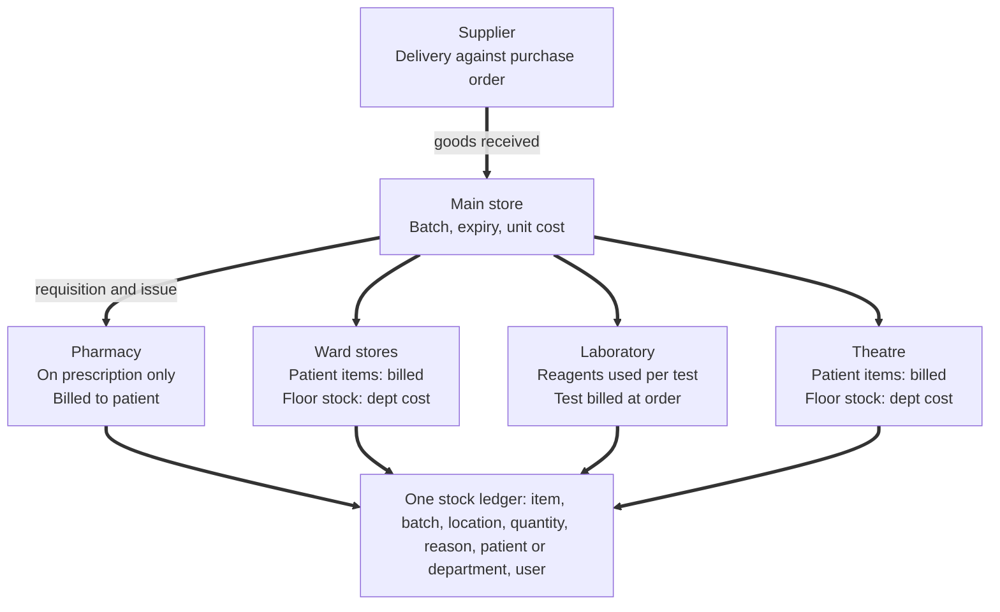
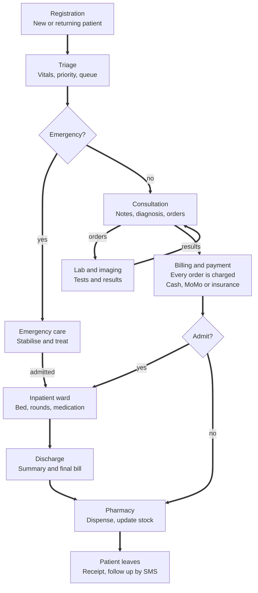

# Hospital Management System: Product Scope

19 October 2026 · Aaron Leonard Oluk

## Overview

A cloud based hospital management system that runs a facility's whole patient journey, from registration to discharge and payment, in one place. Version 1 targets private hospitals, clinics and faith based facilities in Uganda (proposed range: 20 to 200 beds), with Kenya, Rwanda and Tanzania as the next markets.

Most facilities in this segment run on paper registers, a standalone billing tool and Excel. That costs them revenue from services never billed, slow insurance claims, pharmacy stock outs and days of manual monthly reporting to the Ministry of Health.

The product makes three promises: every service rendered is billed, every patient has one record across departments, and statutory reports build themselves from daily work.

## Users and roles

Eleven roles, each seeing only the screens and records their job needs (role based access, every action logged).

| Role | Main work in the system |
| --- | --- |
| Receptionist / records clerk | Register patients, issue patient numbers, book appointments, route to triage |
| Triage nurse | Record vitals, set priority, assign to a clinician queue |
| Doctor / clinical officer | Consult, write notes and diagnoses (ICD 10), order lab and imaging, prescribe, admit or discharge |
| Ward nurse | Bed management, nursing notes, medication administration chart, vitals rounds |
| Lab technician | Receive samples, enter and verify results |
| Radiographer | Receive imaging orders, attach reports and images |
| Pharmacist | Dispense against prescriptions, manage stock, batches and expiry |
| Cashier | Collect payments (cash, mobile money, card), issue receipts, close shifts |
| Insurance / claims officer | Verify cover, track preauthorisation, compile and submit claims |
| Store keeper | Requisitions, purchase orders, goods received, inventory across stores |
| Administrator / management | User setup, price lists, dashboards, Ministry of Health reports |

## Core modules in scope for version 1

Fourteen modules, grouped as clinical, revenue and operations. Must have modules ship in the first release; should have modules follow within the same version.

| Module | What it covers | Priority |
| --- | --- | --- |
| Patient registration and records | Unique patient number, demographics, next of kin, photo, visit history, duplicate detection, search by phone or name | Must have |
| Appointments and queues | Bookings, walk ins, live queue per department and clinician, SMS reminders | Must have |
| Triage | Vitals, chief complaint, priority level, routing to a clinician | Must have |
| Outpatient consultation (OPD) | Clinical notes, history, examination, ICD 10 diagnosis, orders, prescriptions, referral letters | Must have |
| Laboratory | Test catalogue, sample tracking, results entry, reference ranges, verification, printed and SMS results | Must have |
| Pharmacy and dispensing | Prescription queue, dispensing, substitutions, batch and expiry tracking, reorder levels | Must have |
| Billing and cashier | Price lists per payer, automatic charge capture from every order, deposits, receipts, shift close, waivers with approval | Must have |
| Inpatient (IPD) and wards | Admission, bed allocation, ward rounds, nursing notes, medication chart, transfers, discharge summary | Must have |
| Insurance and corporate accounts | Scheme setup, cover limits, preauthorisation, claim batches, remittance matching | Must have |
| Radiology and imaging | Imaging orders, report entry, image attachment | Should have |
| Maternity and theatre | Antenatal visits, delivery register, theatre booking and operation notes | Should have |
| Inventory and procurement | Multiple stores, requisitions, purchase orders, goods received, supplier records | Should have |
| Reports and dashboards | Daily revenue, department activity, disease trends, HMIS 105 and 108 monthly reports | Must have |
| Administration and security | Users, roles, departments, price lists, audit trail, backups | Must have |

## Inventory logic

Inventory covers all three: what is purchased, what is prescribed and dispensed, and what staff use internally. Every movement posts to one stock ledger, so stock on hand in any store is the sum of its movements and each unit traces to a supplier delivery, a patient bill or a department cost.

**Core rules**

1. Prescribing never moves stock. A prescription is an order: it checks availability and shows the price. Stock leaves only when the pharmacist dispenses, and that same action posts the charge to the patient's bill.
2. Stock lives in locations, not one pool. The main store receives purchases; pharmacy, each ward, the lab and theatre hold sub stores refilled by requisition. A transfer lowers one location and raises another, with no charge.
3. Every item carries one of three billing types in the item master:
   * Billable medicine: charged per unit at dispense (tablets, injections, IV fluids)
   * Billable consumable: charged when a nurse records it against a patient (cannula, catheter, suture)
   * Non billable consumable: department cost, never on a patient bill (gloves, cotton, disinfectant)
4. Each receipt records batch, expiry and unit cost; issues pick first expiry first out, so stock value uses the real batch cost.
5. Nothing leaves without a reason. Expiry, damage, loss and count differences are adjustments with a reason code and supervisor approval.

| Movement | Triggered by | Stock effect | Billing effect |
| --- | --- | --- | --- |
| Purchase receipt | Store keeper receives a delivery against a purchase order | Main store up | Supplier payable |
| Requisition and issue | Pharmacy, ward, lab or theatre requests; main store issues | Main store down, sub store up | None |
| Outpatient dispense | Pharmacist dispenses a prescription | Pharmacy down | Charged to the visit, paid before collection or billed to insurer |
| Inpatient supply | Pharmacy dispenses a patient's drugs to the ward | Pharmacy down | Charged to the running inpatient bill |
| Medication administration | Nurse ticks a dose on the medication chart | None, already dispensed | None; proves the dose was given |
| Patient item from ward stock | Nurse records a billable consumable or emergency dose against a patient | Ward store down | Charged to that patient |
| Internal use | Nurse or department records non billable usage per shift | Ward store down | Department cost |
| Lab test run | Result verified | Reagents down per test recipe | None, test billed at order |
| Patient return | Unused drugs returned at discharge | Pharmacy up | Credit to the bill |
| Adjustment | Expiry, damage, loss, count variance | Down or up | Loss report after approval |

**Controls that stop leakage**

* Dispensed versus billed: every dispense line must have a charge line; a daily exception report lists any that do not.
* Dispensed versus administered: inpatient drugs supplied but not charted as given are returned or explained before discharge.
* Ward usage versus bed occupancy: consumable use per occupied bed is compared week on week to flag unusual consumption.
* Scheduled stock counts per location, with variances posted only as approved adjustments.
* Reorder levels per location raise requisitions for sub stores and purchase orders for the main store.

## Patient journey and system flow

Outpatients flow from registration through consultation to billing; admitted and emergency patients settle a final bill at discharge. Both paths close at pharmacy, so no service goes unbilled.

Every step updates the patient record, daily revenue and HMIS reports. Lab and imaging loop back to the same consultation, so results and charges attach to one visit record.

## Integrations and local requirements

The system must fit how Ugandan facilities pay, report and comply, not only how they treat.

| Area | Requirement |
| --- | --- |
| Mobile money | MTN MoMo and Airtel Money collections at the cashier and for deposits, with automatic receipt matching |
| SMS | Appointment reminders, lab result alerts and payment confirmations through a local SMS gateway |
| Ministry of Health reporting | HMIS 105 (outpatient) and HMIS 108 (inpatient) monthly reports generated from records, with export to DHIS2 |
| Insurance | Scheme price lists, cover checks and claim batches for private insurers and corporate accounts; ready for a national health insurance scheme when it starts |
| Data protection | Compliance with the Data Protection and Privacy Act 2019: consent capture, access logs, encryption, registration with the Personal Data Protection Office |
| Lab analysers (later) | Direct result import from common analysers so results are not retyped |
| Accounting | Daily revenue and expense export to accounting software, or the shared finance module used by other company products |

## Technical architecture and non functional requirements

One multitenant cloud platform, with an optional on premises server for facilities on unreliable internet.

**Proposed stack**

* Backend: Laravel API with PostgreSQL, queues for SMS, reports and claim batches
* Web app: responsive single page app used on desktops at stations and tablets on wards
* Deployment: cloud hosted SaaS by default; on premises edge server that syncs to the cloud when the link returns
* Hardware support: thermal receipt printers, barcode wristbands and sample labels, fingerprint or card patient lookup (later)

**Non functional requirements**

* Offline tolerance: registration, triage, consultation and dispensing keep working through an internet outage
* Performance: common screens load in under 2 seconds on a 4G connection
* Availability: 99.5% uptime target for the cloud service
* Security: role based access, encryption in transit and at rest, full audit trail, automatic logout on shared machines
* Backups: daily encrypted backups with tested restores
* Usability: a nurse or receptionist can be productive after one day of training

## Out of scope and later phases

Version 1 leaves out anything that does not serve the core patient and revenue flow.

* Patient mobile app and online booking portal
* Telemedicine and video consultations
* Full PACS imaging server (version 1 attaches images only)
* Human resources and payroll (can link to the existing HRMS product later)
* Multi facility group reporting for hospital chains
* Clinical decision support and AI features, such as triage suggestions and claim rejection prediction

## Delivery phases and timeline

Proposed: about 28 weeks from kickoff to general release, with a pilot facility live by week 18. Durations are estimates to confirm once the team is set.

1. Discovery (weeks 1 to 3): visit 2 to 3 pilot facilities, map their paper forms and price lists, confirm HMIS report fields. Gate: signed pilot agreement.
2. Foundation (weeks 4 to 8): tenancy, users and roles, patient registration, queues, billing engine, audit trail.
3. Outpatient release (weeks 9 to 14): triage, consultation, lab, pharmacy, cashier with mobile money, daily reports.
4. Pilot (weeks 15 to 18): go live at one facility on outpatient, data migration, staff training, daily support.
5. Inpatient and insurance (weeks 19 to 24): admissions, wards, discharge, insurance schemes and claims, HMIS 105 and 108.
6. Hardening and launch (weeks 25 to 28): offline sync, performance, security review, onboarding kit. Gate: pilot facility billing fully through the system for 30 days.

## Pricing model and open questions

Proposed model: a one time setup fee (configuration, data migration, training) plus a monthly subscription tiered by facility size, with the on premises server and lab analyser links as paid add ons. Price points are open until discovery interviews test willingness to pay.

* [ ] Which facility types and bed range do we target first?
* [ ] Which 2 to 3 facilities will pilot, and who is the clinical champion at each?
* [ ] Subscription tiers: by beds, by users, or by monthly patient visits?
* [ ] Which SMS gateway and mobile money aggregator do we use?
* [ ] Do we offer the on premises server in version 1 or only cloud?
* [ ] Product name
